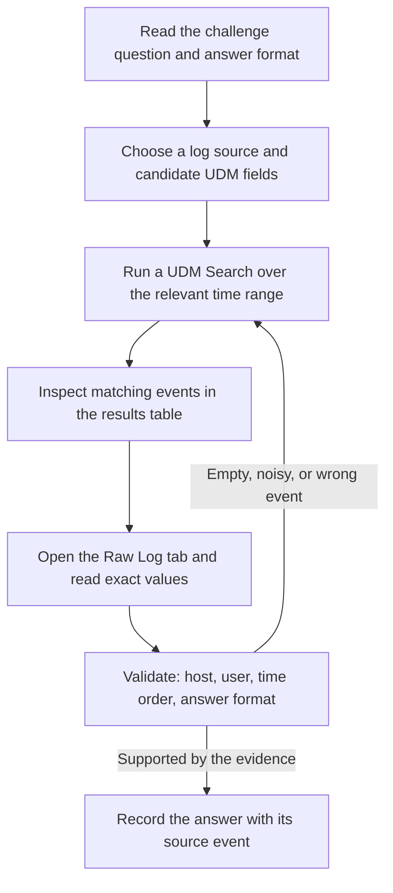

# Google CTF: Security Event Investigation with Google SecOps


This repository documents three blue-team challenges completed in a hosted Google SecOps (formerly Chronicle) environment: Deceptive Click, OAuth Heist, and Rogue Synthesis. Each challenge required searching security telemetry for a fictional organization, reading raw logs, and deriving specific answers from the evidence. The write-up records the queries, the events they returned, what the evidence establishes, and what it does not.

# Google CTF: Security Event Investigation with Google SecOps

This repository documents three blue-team challenges completed in a hosted Google SecOps (formerly Chronicle) environment: Deceptive Click, OAuth Heist, and Rogue Synthesis. Each challenge required searching security telemetry for a fictional organization, reading raw logs, and deriving specific answers from the evidence. The write-up records the queries, the events they returned, what the evidence establishes, and what it does not.

## Table of Contents

- [Overview](#overview)
- [Objectives](#objectives)
- [Environment and Tools](#environment-and-tools)
- [Investigation Methodology](#investigation-methodology)
- [Challenge 1: Deceptive Click](#challenge-1-deceptive-click)
- [Challenge 2: OAuth Heist](#challenge-2-oauth-heist)
- [Challenge 3: Rogue Synthesis](#challenge-3-rogue-synthesis)
- [Cross-Challenge Technical Analysis](#cross-challenge-technical-analysis)
- [Lessons Learned](#lessons-learned)
- [Limitations](#limitations)
- [Further Practice](#further-practice)
- [References](#references)

## Overview

Google SecOps is a cloud security information and event management (SIEM) platform. A SIEM collects logs from many systems, converts them into a common structure, and makes them searchable in one place. The three challenges were hosted through Hack The Box and ran against a shared SecOps tenant containing data for a fictional organization (Cymbal Investments, internal domain `cymbal.corp`). There was no target host to attack. All work was performed in the SecOps web interface.

The central activity in every challenge was the same: choose a log source, search it with a Unified Data Model (UDM) query, open the matching event, read the raw log, and extract the value the challenge question asked for. The most complete record exists for Rogue Synthesis, which is documented in detail. Deceptive Click and OAuth Heist are documented to the extent the preserved evidence supports.

### Scope and disclosure

- The exercises used curated, fictional data. This write-up does not claim experience in SIEM administration, detection engineering at scale, or real-world incident response.
- Flag values are not published. The CTF's publication rules were not available when this document was prepared, so answer values are replaced with angle-bracket placeholders such as `<exfil-domain>`. Identifiers that are not answers (hosts, process IDs, timestamps, unrelated file names) are kept because the correlation depends on them.
- The developer account name in Rogue Synthesis is itself an answer to the first question, so it appears as `<developer-account>`.
- Sign-in codes, the tenant address, and an API key that appeared in a proxy log URL are omitted or redacted.
- Evidence provenance differs by section. Where a raw log is reproduced, it is trimmed to the relevant fields. Where only recorded fields are given, they are presented as a table rather than as a log.

## Objectives

The tasks exercised the following skills:

- Selecting the log source most likely to hold the answer (web proxy, endpoint, Windows Security, workspace activity).
- Writing UDM Search expressions with exact-match and regular-expression conditions.
- Narrowing broad results with positive filters (host, user, event type) and diagnosing empty or noisy results.
- Reading Sysmon process, file, and injection events (Event IDs 1, 8, 11) and Windows authentication events (4624, 4769).
- Reading web proxy records for download, upload, and POST activity.
- Following a process identifier (PID) across events to link actions to one process.
- Reconciling timestamps between the results table and the raw log.
- Copying answer values exactly as written in the raw log, including casing.

## Environment and Tools

| Component | Detail |
|---|---|
| Platform | Google SecOps web interface in a Hack The Box hosted tenant |
| Query interface | UDM Search (event search over normalized UDM fields) |
| Other interface features used | Results table, Raw Log tab for each event, event-type filtering |
| Query syntax | `field operator value`, combined with `AND`; regular expressions written as `/pattern/` with the `nocase` modifier |
| Not used | YARA-L detection rules were not written in these challenges |

Google's documentation describes search expressions as built from a UDM field, an operator, and a value, and describes search as using YARA-L 2.0 syntax. UDM Search is the event search feature. YARA-L rules, which generate detections, are a separate use of the language.

Log sources observed:

| Source | Raw format | Appears in |
|---|---|---|
| Zscaler web proxy | Tab-delimited `key=value` text (fields include `requestmethod`, `url`, `hostname`, `clientIP`, `user`, `filetype`, `requestsize`, `event_timestamp`) | All three challenges |
| Sysmon (Microsoft system monitor) | Windows event XML | All three challenges |
| Windows Security events | Windows event records (Event IDs 4624, 4769) | Deceptive Click, OAuth Heist |
| Gmail and Drive activity logs | Workspace activity records | OAuth Heist |

The tenant also contained data from unrelated labs, with different hostnames. Cymbal data used the `*.cymbal.corp` naming, which made `cym` a usable positive filter.

All Rogue Synthesis queries were run over the whole day, 2026-10-15.

## Investigation Methodology

The workflow below was applied most completely in Rogue Synthesis. The records for the other two challenges do not show every step.



1. **Interpret the question.** Identify what kind of event would contain the answer, for example a file download, a process launch, or a POST request.
2. **Choose telemetry and fields.** Map the event kind to a source and a UDM field, such as `target.url` for proxy requests or `metadata.event_type` for endpoint events.
3. **Search.** Start with a pattern broad enough to find candidates, then add positive filters.
4. **Inspect events and raw logs.** The results table summarizes an event. Fields such as the full command line live in the raw log.
5. **Extract and validate.** Check that the event belongs to the right host and user, falls in the right order relative to other events, and matches the requested format.
6. **Correlate.** Link events through shared identifiers (user, host, PID, file path). In Rogue Synthesis the PID of an injected process linked an injection event to a later credential-file read.
7. **Derive the answer.** Copy the value from the raw log, and record any link that remains unproven.

## Challenge 1: Deceptive Click

### Objective

Six questions about a compromise in the Cymbal environment. The exact question text was not preserved. The recorded answers fall into these categories:

| # | Answer type | Source recorded |
|---|---|---|
| 1 | Hostname of the affected workstation | Not recorded |
| 2 | Registered domain of a referring site | Zscaler proxy, inferred from timing |
| 3 | A process ID | Sysmon Event ID 8, `TargetProcessId` field |
| 4 | A Kerberos service principal name (SPN) | Windows Event ID 4769 raw log |
| 5 | A service account name | Windows Event ID 4624 on the host `CYM-FS-01` |
| 6 | An archive file name | Sysmon Event ID 11 on the host `CYM-FS-01` |

### Investigation

The queries used for this challenge were not preserved. One verification query was identified for question 2 but is not recorded as having been run:

```text
metadata.log_type = "ZSCALER_WEBPROXY" AND principal.user.userid = "marcus.vance" AND target.hostname = "static.cdn-updater-distribution.net"
```

Its purpose is to isolate one user's proxy visits to one destination so that the `refererURL` field of the raw log can be read. Conditions: `metadata.log_type` restricts the search to one parser (log source), `principal.user.userid` restricts it to one user, and `target.hostname` restricts it to one destination host. If the referer differs from the timing-based candidate, the referer domain would replace it.

### Evidence and Analysis

Only summaries of the evidence were preserved, not the raw logs. The recorded status per answer:

| # | Status |
|---|---|
| 1 | Accepted by the platform. The host name was entered with the host portion in uppercase and the domain portion in lowercase, exactly as logged. |
| 2 | Not verified. Derived from timing; the `refererURL` check above was not recorded as completed. |
| 3 | Taken from the raw Sysmon Event ID 8 log. |
| 4 | Taken from the raw Event ID 4769 log. |
| 5 | Taken from an Event ID 4624 on `CYM-FS-01`. |
| 6 | Taken from a Sysmon Event ID 11 on `CYM-FS-01`. |

### Result

Answers were recorded for all six questions. Question 2 remains the weakest because it rests on timing alone. Platform feedback for questions 2 to 6 was not preserved. A narrative linking the six findings into a single attack chain was not recorded, so none is asserted here.

### Technical Takeaways

- Case matters in submitted values. The accepted host name preserved the exact mixed casing of the raw log.
- Sysmon Event ID 8 (CreateRemoteThread) records one process creating a thread in another process. The event carries the identifier of the target process.
- Windows Event ID 4769 records a Kerberos service ticket request; the requested service appears in the event. Event ID 4624 records a successful logon. Sysmon Event ID 11 records file creation. These definitions are background, not drawn from the preserved evidence.
- A timing-based candidate is a hypothesis. A field in the raw log, such as `refererURL`, can confirm or replace it.

## Challenge 2: OAuth Heist

### Objective

Six questions tracing activity from a web authentication request through workspace activity to database access and data exfiltration. The exact question text was not preserved.

### Investigation

The queries were not preserved. The recorded evidence sources are listed below with raw timestamps in UTC.

### Evidence and Analysis

| # | Answer type | Evidence recorded |
|---|---|---|
| 1 | A domain | Zscaler POST to the path `/api/v1/auth/token` at 19:17:10, user `elena.rostova` |
| 2 | An Okta notification subject | Gmail activity log at 19:40:15Z, associated with an OAuth client ID. A second notification at 19:41:35Z was kept as a fallback candidate. |
| 3 | A PDF file name | Drive `item_download` event at 20:06:45Z |
| 4 | A service account name | Windows Event ID 4624 on `CYM-DB-01` at 20:30:20Z, source address `10.240.12.65` |
| 5 | A backup file name | Sysmon Event ID 1 showing a `sqlcmd` backup command at 20:33:05Z |
| 6 | An upload URL | Zscaler POST at 21:33:15, `clientIP=10.240.32.100`... see note below |

Note on row 6: the recorded client address was `10.240.12.100`, the user was `<service-account>` (the answer to question 4), the file type was ZSTD (a compressed archive format), and the request size was about 485 MB. The preserved notes record that this matches a Sysmon Event ID 3 (network connection) at 21:32:55Z to the same external address and port, 20 seconds earlier.

The 4624 logon in row 4 originated from `10.240.12.65`, while the later upload came from `10.240.12.100`. The preserved notes do not explain the relationship between the two addresses, and none is asserted.

### Result

Answers were recorded for all six questions. Platform acceptance of individual answers was not preserved. Question 2 was the least certain, which is why a fallback candidate was noted.

### Technical Takeaways

- Two independent sources describing one event strengthen a finding. Here the proxy POST and the Sysmon connection event agree on destination and timing.
- Different log families answer different questions: workspace activity logs for account actions, Windows Security for logons, Sysmon for commands and connections, the proxy for transfer size and destination.
- A logon event shows that an account authenticated from an address. It does not show how the account was obtained.

## Challenge 3: Rogue Synthesis

### Objective

Category: AI misuse, six questions. The challenge was framed around a Google Threat Intelligence (GTI) bulletin on AI-enabled threats (the "GTIG AI Threat Tracker"). The task was to hunt the initial compromise and find the adversary's ultimate target in the continuous integration and delivery (CI/CD) pipeline. The supplied bulletin PDF was background material and contained no lab data.

| # | Question (paraphrased) | Format |
|---|---|---|
| 1 | Developer username that initiated a request to the model used by the AI threat | `user.name` |
| 2 | Package downloaded immediately before the API query | `File_Name.extension` |
| 3 | Compiled executable dropped into the malware's local staging directory after the outbound API request | `file_name.extension` |
| 4 | After privilege elevation through process hollowing, the existing file in the user's local cloud SDK configuration directory that the injected process read to harvest tokens | `file_name.extension` |
| 5 | External domain that received the stolen data through an HTTP POST to a telemetry-style URI path | `domain-name.com` |
| 6 | PowerShell script overwritten through PowerShell to establish persistence on the secondary server, reached by pivoting with the harvested service account | `file_name.extension` |

### Investigation and Evidence

All queries below were executed in UDM Search over 2026-10-15. Results for questions 1 to 3 are recorded as event fields. Results for questions 4 to 6 include reproduced raw logs.

#### Question 1: model API request

```text
target.hostname = /generativelanguage|huggingface|inference/ nocase
```

Syntax: `target.hostname` is the destination host of the request. The `/.../` form is a regular expression, `|` means "or", and `nocase` ignores letter case. The pattern lists hostnames typical of hosted AI model APIs.

The search returned one Zscaler event:

| Field | Value |
|---|---|
| Time | 20:06:50 |
| Method and URL | POST `https://generativelanguage.googleapis.com/v1beta/models/gemini-1.5-flash-latest:generateContent?key=<REDACTED>` |
| User agent | `node-fetch/3.3.2` |
| Client IP | `10.240.12.80` |
| User | `<developer-account>` |
| Status and app | 200, "Google Gemini API" |

Analysis: the URL is a generative-model API call. `node-fetch` is a Node.js HTTP library rather than a browser, which indicates a program made the request. The investigation notes record that the model identifier matches the one named in the bulletin. This was the only hit, so no alternative candidate competed with it.

#### Question 2: package download

First attempt:

```text
principal.user.userid = "<developer-account>" AND target.url = /npm|pypi|registry|tgz|whl|zip|tar/ nocase
```

Result: only a VS Code Marketplace search page. The pattern `tar` matched inside the query string `target=VSCode`, so the match was a false positive. It did, however, point to Visual Studio Code extensions as the relevant package type.

Second attempt:

```text
principal.user.userid = "<developer-account>" AND target.url = /vsix|vspackage|vsassets|gallery/ nocase
```

Result: one Zscaler event at 20:01:20.

| Field | Value |
|---|---|
| Method and URL | GET `https://marketplace.visualstudio.com.cdn-cache.net/extensions/DevTools/<extension>/<version>/<package-file>.vsix` |
| File type | VSIX |
| User agent | `VSCode/1.89.1` |
| Referer | `...items?itemName=DevTools.<extension>` |

Analysis: `.vsix` is the VS Code extension package format. The destination is `marketplace.visualstudio.com.cdn-cache.net`. The registered domain is the right-most labels, `cdn-cache.net`, so the legitimate-looking prefix is only a subdomain of an unrelated domain. A Marketplace search for linters at 19:53:35 preceded the download. The download is 5 minutes before the 20:06:50 API call, consistent with the question. This was the only `.vsix` event the query returned.

#### Question 3: compiled executable

Filtering on `FILE_CREATION` events did not return the executable. The sequence of queries and the observation that drove each change:

1. Filter on `metadata.event_type = "FILE_CREATION"`, `principal.ip = "10.240.12.80"`, and `target.file.full_path = /exe/ nocase`. No results. The same filter with a user condition also returned nothing. Sysmon events in this tenant did not match on `principal.ip`, which was also an empty-result pattern later.
2. Remove the host and user filters: `metadata.event_type = "FILE_CREATION" AND target.file.full_path = /exe/ nocase`. 237 rows, mostly prefetch (`.pf`) files from an unrelated lab host. The pattern `exe` was too short and common.
3. Add exclusions for prefetch and for the unrelated host. Result: rows from other labs. Exclusion filters did not help because the noise came from many sources.
4. Switch to a positive filter on the organization's naming:

```text
metadata.event_type = "FILE_CREATION" AND principal.hostname = /cym/ nocase
```

Result: Cymbal rows, including two Sysmon Event ID 11 events on `CYM-DEV-WS-019.cymbal.corp`, both created by `node.exe`: `thinking_robot_log.txt` and `cache_worker.c`. No `.exe` file.

5. Confirm the staging directory:

```text
principal.hostname = "CYM-DEV-WS-019.cymbal.corp" AND target.file.full_path = /<developer-account>.*temp/ nocase
```

Result: the same two events, confirming the directory is `C:\Users\<developer-account>\AppData\Local\Temp\`.

6. Look at process launches instead of file creations:

```text
principal.hostname = "CYM-DEV-WS-019.cymbal.corp" AND metadata.event_type = "PROCESS_LAUNCH"
```

Result: 11 rows. The row for `gcc.exe` launched by `node.exe` held the answer in its raw log. Recorded fields of the Sysmon Event ID 1 event (raw time 20:08:20Z):

| Field | Value |
|---|---|
| Command line | `gcc.exe -O2 C:\Users\<developer-account>\AppData\Local\Temp\cache_worker.c -o C:\Users\<developer-account>\AppData\Local\Temp\<compiled-binary>.exe` |
| Parent | `node.exe`, PID 6720 |
| Parent command line | `...\.vscode\extensions\<extension-folder>\out\optimizer-daemon.js` |

Analysis: the `-o` argument of `gcc` names the output file. The parent command line ties the compiler run to the extension identified in question 2. The compile at 20:08:20 follows the API call at 20:06:50.

Uncertainty: no file-creation event for the compiled executable was found. The answer rests on the compiler command line, which is strong evidence that the file was written but is not a direct observation of the write.

#### Question 4: file read by the injected process

First query:

```text
principal.hostname = "CYM-DEV-WS-019.cymbal.corp" AND target.file.full_path = /gcloud/ nocase
```

Result: the returned event was a Sysmon Event ID 8, not a file read. The reason it matched this filter was not examined. The event identified the injection. Recorded fields (raw time 20:16:15Z):

| Field | Value |
|---|---|
| Source image | `...\Temp\<compiled-binary>.exe`, PID 7140 |
| Target image | `C:\Windows\System32\svchost.exe`, PID 624 |
| Source user | `CYMBAL\<developer-account>` |
| Target user | `NT AUTHORITY\SYSTEM` |
| Rule tag | T1055.012 (process hollowing, a lab annotation) |

Second query, pivoting on the target PID:

```text
principal.hostname = "CYM-DEV-WS-019.cymbal.corp" AND principal.process.pid = "624"
```

Syntax: `principal.process.pid` is the PID of the acting process. The value is quoted because the field is searched as a string here.

Result: one event, reproduced here with the relevant fields only (Sysmon Event ID 1, original evidence):

```xml
<TimeCreated SystemTime="2026-10-15T20:29:15.000Z"/>
<Computer>CYM-DEV-WS-019.cymbal.corp</Computer>
<Data Name="RuleName">technique_id=T1003.008,technique_name=/etc/passwd and /etc/shadow or Cloud Tokens</Data>
<Data Name="Image">C:\Windows\System32\cmd.exe</Data>
<Data Name="CommandLine">cmd.exe /c "type C:\Users\<developer-account>\.gcloud\<credential-file>"</Data>
<Data Name="User">CYMBAL\<developer-account></Data>
<Data Name="ParentProcessId">624</Data>
<Data Name="ParentImage">C:\Windows\System32\svchost.exe</Data>
<Data Name="ParentCommandLine">C:\Windows\system32\svchost.exe -k netsvcs -p</Data>
<Data Name="ParentUser">NT AUTHORITY\SYSTEM</Data>
```

| Field | What it establishes |
|---|---|
| `ParentProcessId` 624 | The `cmd.exe` process was started by the process the injection event identified as its target |
| `ParentUser` `NT AUTHORITY\SYSTEM` | The parent ran with system privileges |
| `CommandLine` with `type` | `type` prints a file's contents, so the file in the `.gcloud` directory was read |
| `RuleName` | Lab-supplied annotation; not used as evidence |

Uncertainty: the evidence is a command line, not a file-access event. The cloud SDK directory in this lab is `.gcloud` under the user profile. Only one PID 624 event was reviewed, so other files read by the same process were not ruled out.

#### Question 5: exfiltration domain

```text
network.http.method = "POST" AND target.url = /telemetry|metrics|analytics|collect|beacon/ nocase
```

Syntax: `network.http.method` restricts to POST requests, and the URL pattern matches common telemetry-style path words.

Result: two Zscaler events.

| Field | Event 1 | Event 2 |
|---|---|---|
| Time | 20:36:45 | 20:09:05 |
| User | `<developer-account>` | `marcus.vance` |
| Client IP | `10.240.12.80` | `10.240.32.115` |
| URL | `https://<exfil-domain>/api/v2/telemetry` | `https://cdn-metrics-analytics.net/api/v1/telemetry` |
| Department | Cloud Engineering and DevOps | Global Marketing |
| Request size (bytes) | 4200 | 1428 |

Selected fields of Event 1 (original evidence, fields reordered):

```text
event_timestamp=2026-10-15 20:36:45
requestmethod=POST
url=https://<exfil-domain>/api/v2/telemetry
hostname=<exfil-domain>
requestsize=4200
responsesize=14200
status=200
useragent=Mozilla/5.0 (Windows NT 10.0; Win64; x64) AppleWebKit/537.36 (KHTML, like Gecko) Chrome/124.0.0.0 Safari/537.36
appname=General Browsing
department=Cloud Engineering & DevOps
clientIP=10.240.12.80
user=<developer-account>
```

Analysis: Event 1 comes from the same user and client address as the earlier activity and occurs about 7.5 minutes after the credential read at 20:29:15Z. Event 2 belongs to a different user and precedes the credential read. The answer was chosen by elimination on user, time, and path.

Uncertainties:

- The POST was not linked to the injected process. The recorded user agent is a Chrome string and the application label is "General Browsing". A Sysmon network-connection event from PID 624 would link them, but that query was not run.
- The request body is not logged, so nothing shows that tokens were inside it. The small request size is consistent with a few tokens but is not proof.
- The mapping of client IP `10.240.12.80` to the workstation `CYM-DEV-WS-019` was assumed and never checked directly.
- `marcus.vance` also appears in Deceptive Click evidence. The relationship of Event 2 to that challenge was not examined.

#### Question 6: overwritten PowerShell script

```text
principal.hostname = "CYM-CI-RUNNER-01.cymbal.corp" AND target.file.full_path = /ps1/ nocase
```

A broader search, `metadata.event_type = "FILE_CREATION" AND principal.hostname = /cym/ nocase`, had earlier listed this event in the results table. The targeted query returned one event, reproduced with the relevant fields (Sysmon Event ID 11, original evidence):

```xml
<TimeCreated SystemTime="2026-10-15T21:46:05.000Z"/>
<Computer>CYM-CI-RUNNER-01.cymbal.corp</Computer>
<Data Name="RuleName">technique_id=T1505.003,technique_name=Build Hook Injection</Data>
<Data Name="Image">C:\Windows\System32\WindowsPowerShell\v1.0\powershell.exe</Data>
<Data Name="TargetFilename">C:\BuildRunner\scripts\<script-name>.ps1</Data>
<Data Name="CreationUtcTime">2026-10-15 21:46:05.000</Data>
<Data Name="User">CYMBAL\svc_cicd_deploy</Data>
```

| Field | What it establishes |
|---|---|
| `Computer` | A different host from the developer workstation, consistent with the "secondary server" in the question |
| `Image` | The file was written by `powershell.exe` |
| `TargetFilename` | A script in a build-runner scripts directory |
| `User` | The write was performed by a CI/CD service account |
| `UtcTime` 21:46:05Z | After the exfiltration POST at 20:36:45 |

Uncertainties:

- `CreationUtcTime` equals `UtcTime`. Sysmon Event ID 11 is logged for both new files and overwrites, so this log neither shows nor excludes an overwrite. That part of the question is supported only by the challenge wording.
- A logon into `CYM-CI-RUNNER-01` by the service account from the workstation was not examined. A search on `metadata.event_type = "USER_LOGIN"` for that host was identified as the next check and not run.
- How the service account was obtained is unproven.
- Other `.ps1` events on that host would change the conclusion. Only one was reviewed.
- The rule tag in the log is a lab annotation and was not used as evidence.

### Timeline

Times are raw UTC. The results table showed Sysmon events one hour later than the raw log (for example, 22:46:05 for a raw 21:46:05Z); Zscaler table times matched raw times.

| Time | Source | Event |
|---|---|---|
| 19:53:35 | Zscaler | Developer account browses the Marketplace for linters |
| 20:01:20 | Zscaler | Extension package downloaded from a lookalike CDN domain |
| 20:06:50 | Zscaler | POST to the Gemini `generateContent` endpoint |
| 20:07:15 | Sysmon 11 | `node.exe` (PID 6720) creates `thinking_robot_log.txt` in Temp |
| 20:07:35 | Sysmon 11 | `node.exe` creates `cache_worker.c` in Temp |
| 20:08:20 | Sysmon 1 | `node.exe` launches `gcc.exe`, compiling the executable |
| 20:16:15 | Sysmon 8 | Compiled executable (PID 7140) injects into `svchost.exe` PID 624 |
| 20:29:15 | Sysmon 1 | `cmd.exe`, child of PID 624, reads the credential file with `type` |
| 20:36:45 | Zscaler | POST to the telemetry-style path |
| 21:46:05 | Sysmon 11 | `powershell.exe` writes a script on `CYM-CI-RUNNER-01` |

The investigation notes record `thinking_robot_log.txt` as the log file named in the bulletin.

```mermaid
flowchart LR
    A["20:01:20 Extension package downloaded"] -.->|"time and user"| B["20:06:50 POST to Gemini API"]
    B -.->|"time and user"| C["20:07:15 node.exe writes files to Temp"]
    C -->|"same process node.exe PID 6720"| D["20:08:20 gcc compiles binary"]
    D -->|"compiled binary is injection source"| E["20:16:15 Injection into svchost.exe PID 624"]
    E -->|"same PID 624"| F["20:29:15 cmd.exe reads credential file"]
    F -.->|"user and later time only"| G["20:36:45 POST to telemetry path"]
    G -.->|"no logon evidence reviewed"| H["21:46:05 PowerShell writes script on CI runner"]
```



Solid arrows mark links supported by a shared process, PID, or file. Dashed arrows mark links that rest on user, host, and time ordering only.

### Result

Questions 1 to 4 were derived from specific events. Question 5 was derived by elimination among two candidate events. Question 6 was derived from a file-creation event that matches the question's description but cannot confirm an overwrite. Platform feedback on individual Rogue Synthesis answers was not preserved.

### Technical Takeaways

- **Pivoting on a PID.** The injection event named the target PID. Searching that PID returned the later action performed by the hollowed process.
- **Command lines as evidence.** A missing file-creation event did not mean the file did not exist. The `-o` argument in the compiler's command line was the evidence.
- **Regular-expression precision.** Short patterns (`exe`, `tar`) match far more than intended.
- **Positive filters over exclusions.** Selecting the organization's hosts with `/cym/` worked where excluding other labs' hosts did not.
- **Field population varies by source.** `principal.ip` returned nothing for Sysmon events, so host-based filters were used instead.
- **Lookalike domains.** `marketplace.visualstudio.com.cdn-cache.net` is a subdomain of `cdn-cache.net`.

## Cross-Challenge Technical Analysis

The three challenges share a tenant, the `cymbal.corp` naming, and several log sources. They are treated as separate scenarios. No single attack chain across them is asserted.

### Search and filtering

A UDM Search expression combines a field, an operator, and a value. Exact match (`=`) is precise but needs the exact field and value. Regular expressions are flexible but match substrings anywhere in the field. A synthetic illustration of the over-matching seen in Rogue Synthesis:

```text
Pattern:  /tar/
Matches:  https://example.test/page?target=abc    (matches "tar" inside "target")
```

This example is illustrative, not evidence from the lab. Time range is set in the interface, not in the query, so an empty result can also mean the range is wrong.

### Raw versus normalized events

SecOps parses each raw log into UDM fields so the same field names apply across sources. Parsing is not uniform. In this tenant `principal.ip` did not match on Sysmon events, the results table showed Sysmon times one hour ahead of the raw log, and the table row for the compiler launch did not show the output file that the raw command line did. The raw log was the reliable source for exact strings.

### Timestamps and correlation

Raw timestamps were used for ordering. The table offset was observed on Sysmon rows in Rogue Synthesis and was not assumed to hold in other challenges. Correlation depended on shared identifiers: a user name, a host name, a PID, a file path. A shared identifier supports a link. Time ordering and a matching user without a shared process identifier supports it only weakly, as in the exfiltration POST.

### Relevant event versus proven activity

Several findings identified the event that answers the question without proving the whole story:

- The compiled executable was inferred from a compiler command, not a file-creation event.
- The credential file was inferred from a command line, not a file-access event.
- The exfiltration domain was chosen by elimination, without linking the POST to the injected process.
- The script event is consistent with an overwrite, but the log does not show one.

Stating the gap beside each answer keeps the conclusion proportional to the evidence.

## Lessons Learned

Practiced during the challenges:

- Running and refining UDM Search queries from observed results, including recovering from over-broad regular expressions and empty results.
- Opening the Raw Log tab to read exact field values, and copying answers with their original casing.
- Following a PID from an injection event to a later process action.
- Reconciling table times with raw times before ordering events.

Consolidated in a later review:

- The distinction between principal (the actor) and target (the object acted on) in UDM.
- The difference between UDM Search and YARA-L detection rules.
- Which statements each event type supports and which it does not, such as the difference between a command line and a file-access event.
- Mapping observed behavior to MITRE ATT&CK techniques, for example process hollowing (T1055.012).

## Limitations

- The data was curated and fictional, with a defined storyline and a small number of decoys. Real environments contain far more events, benign administrative activity, and gaps in logging.
- The tenant also held unrelated data from other labs, which added noise that a real tenant would not contain in this form.
- No alerts or detections were provided. Investigation started from the challenge questions.
- Queries, raw logs, and question text for Deceptive Click and OAuth Heist were not preserved, so those sections are limited to recorded summaries.
- For Rogue Synthesis, raw logs were reproduced for questions 4 to 6 only. Questions 1 to 3 are documented from recorded field values.
- Platform acceptance of individual answers was not preserved, apart from the first Deceptive Click answer.
- Rule tags in the logs are lab annotations and were not validated against ATT&CK.
- The challenges did not provide visibility into the underlying infrastructure, so parsing behavior (for example the Sysmon time offset) could be observed but not explained.

## Further Practice

- Run the checks left open in Rogue Synthesis: a `USER_LOGIN` search on the CI runner for the service account, and a network-connection search for PID 624, to test the unproven links.
- Practice Windows authentication analysis with Event IDs 4624, 4625, and 4769, focusing on logon types and source addresses.
- Convert one hunt, such as an extension host spawning a compiler, into a YARA-L detection rule to understand how searches become detections.
- Build a baseline of normal behavior for a user or host before judging an event as suspicious.

## References

- Google Cloud, [Search in Google SecOps](https://docs.cloud.google.com/chronicle/docs/investigation/udm-search)
- Google Cloud, [Search best practices](https://docs.cloud.google.com/chronicle/docs/investigation/udm-search-best-practices)
- Google Cloud, [Overview of the Unified Data Model](https://docs.cloud.google.com/chronicle/docs/event-processing/udm-overview)
- Microsoft, [Sysmon documentation](https://learn.microsoft.com/en-us/sysinternals/downloads/sysmon)
- MITRE, [T1055.012: Process Injection, Process Hollowing](https://attack.mitre.org/techniques/T1055/012/)
